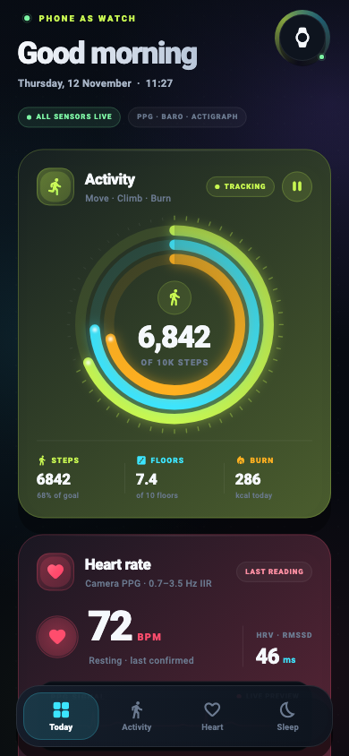
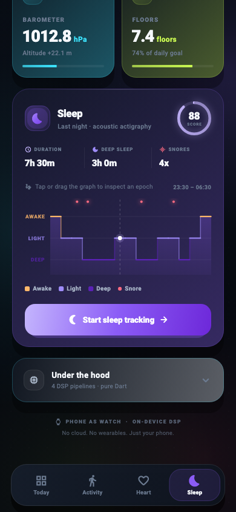
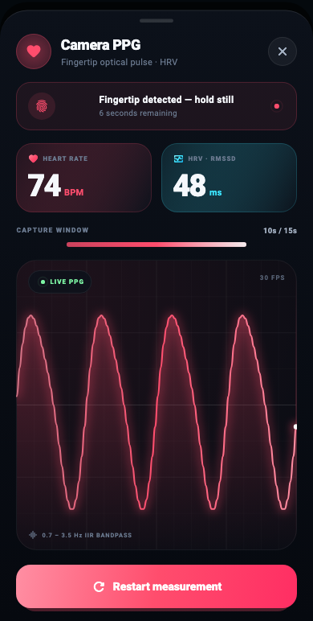

# PhoneAsWatch ⌚📱

**PhoneAsWatch** adalah aplikasi kesehatan cerdas berbasis Flutter yang mereplikasi seluruh sensor utama smartwatch (Heart Rate PPG, HRV, Pedometer, Barometer Altimeter, dan Sleep Actigraphy Tracker) menggunakan hardware bawaan smartphone dengan algoritma Digital Signal Processing (DSP) murni di Dart.

> 📦 **Baru di sini?** Panduan instalasi Android/iOS, build APK, dan troubleshooting ada di **[INSTALL.md](INSTALL.md)**.  
> ✅ Android 11–16 didukung (minSdk 24, targetSdk 36).

## 📸 UI Preview

<p align="center">
  
  
  
</p>

<p align="center">
  <sub>Dashboard • Sleep hypnogram interaktif • Camera PPG monitor<br/>
  <a href="docs/preview/dashboard-full.png">Lihat tampilan lengkap →</a></sub>
</p>

---

## 🏗️ Struktur Arsitektur Proyek

```
phone-as-watch/
├── pubspec.yaml
├── analysis_options.yaml
├── README.md
├── android/
│   └── app/src/main/
│       └── AndroidManifest.xml          # Izin Kamera, Torch, Sensor, Mic, Wakelock
├── ios/
│   └── Runner/
│       └── Info.plist                   # Deskripsi Izin Sensor iOS
├── lib/
│   ├── main.dart                        # MultiProvider & App Entrypoint
│   ├── core/
│   │   ├── constants/
│   │   │   └── app_colors.dart          # Token Warna Smartwatch Luxury Dark UI
│   │   └── theme/
│   │       └── app_theme.dart           # Konfigurasi Tema OLED Dark Mode
│   ├── features/
│   │   ├── heart_rate/                  # FITUR 1: Camera PPG & HRV
│   │   │   ├── dsp/
│   │   │   │   ├── biquad_filter.dart   # 2nd-Order Butterworth Bandpass (0.7 - 3.5 Hz)
│   │   │   │   ├── ppg_signal_processor.dart # Adaptive Threshold Peak, IBI, RMSSD
│   │   │   │   └── yuv_converter.dart   # YUV420 & BGRA8888 -> Red ROI Luminance
│   │   │   ├── services/
│   │   │   │   └── camera_ppg_service.dart # Camera Stream & Torch Controller
│   │   │   └── presentation/
│   │   │       ├── controllers/
│   │   │       │   └── heart_rate_controller.dart
│   │   │       └── widgets/
│   │   │           ├── live_waveform_painter.dart # Real-time Plethysmogram Painter
│   │   │           └── heart_rate_monitor_sheet.dart
│   │   ├── activity/                    # FITUR 2: Pedometer & Barometer Altimeter
│   │   │   ├── dsp/
│   │   │   │   └── step_detector.dart   # Vector Magnitude & Refractory Cadence
│   │   │   ├── services/
│   │   │   │   └── activity_tracker_service.dart # Hypsometric Floor Ascent
│   │   │   └── presentation/
│   │   │       └── controllers/
│   │   │           └── activity_controller.dart
│   │   └── sleep/                       # FITUR 3: Bed Actigraphy & Sonar
│   │       ├── dsp/
│   │       │   └── sleep_classifier.dart # Mattress Variance & Snore Burst Detector
│   │       ├── services/
│   │       │   └── sleep_tracker_service.dart # WakelockPlus & Audio Stream
│   │       └── presentation/
│   │           └── controllers/
│   │               └── sleep_controller.dart
│   └── presentation/                    # FITUR 4: Smartwatch Companion UI
│       ├── dashboard_screen.dart        # Ambient dashboard + scroll-aware nav
│       └── widgets/
│           ├── ambient_background.dart  # Aurora gradient & dot-matrix backdrop
│           ├── animated_counter.dart    # Tweened live numeric readouts
│           ├── circular_progress_widget.dart # Animated gradient tri-ring
│           ├── entrance.dart            # Staggered fade-and-rise entrance
│           ├── floating_nav_bar.dart    # Glass bottom nav + section anchors
│           ├── glass_card.dart          # Gradient-stroke glass panel
│           ├── metric_card.dart         # Glassmorphic metric tile
│           ├── mini_ecg.dart            # Scrolling ECG signal strip
│           ├── pressable_scale.dart     # Tactile press + haptic feedback
│           ├── pulse_dot.dart           # Live-tracking status dot
│           ├── score_gauge.dart         # Animated circular score gauge
│           └── sleep_stage_chart.dart   # Interactive animated hypnogram
└── test/
    ├── ppg_dsp_test.dart                # Unit Test Filter IIR & Heart Rate
    ├── activity_step_test.dart          # Unit Test Langkah & Cadence
    └── sleep_classifier_test.dart       # Unit Test Klasifikasi Tidur
```

---

## 🧮 Landasan Matematika & Digital Signal Processing (DSP)

Semua algoritma pemrosesan sinyal diimplementasikan langsung dalam kode Dart tanpa dependensi pihak ketiga:

### 1. Camera Photoplethysmography (PPG) & HRV
- **Ekstraksi Kanal Merah (YUV420 & BGRA8888):**
  Menggunakan standar ITU-R BT.601 pada *Region of Interest* (ROI 30% x 30% di tengah frame) untuk memaksimalkan frame rate hingga 30-60 FPS:
  $$\text{Red} = Y + 1.402 \times (V - 128)$$
- **2nd-Order Butterworth Bandpass Filter (0.7 Hz – 3.5 Hz / 42 – 210 BPM):**
  Mengeliminasi baseline drift/respirasi ($< 0.7\text{ Hz}$) dan noise sensor/kedipan lampu ($> 3.5\text{ Hz}$):
  $$y[n] = b_0 x[n] + b_1 x[n-1] + b_2 x[n-2] - a_1 y[n-1] - a_2 y[n-2]$$
- **Adaptive Peak Detection:**
  Ambang batas bergerak adaptif:
  $$T[n] = \mu_{\text{local}} + 0.35 \times \sigma_{\text{local}}$$
  Dilengkapi periode refraktori $270\text{ ms}$ ($\max 222\text{ BPM}$) guna mencegah deteksi ganda akibat dicrotic notch.
- **Inter-Beat Interval (IBI) & Heart Rate Variability (HRV - RMSSD):**
  $$RMSSD = \sqrt{\frac{1}{N-1} \sum_{i=1}^{N-1} (IBI_{i+1} - IBI_i)^2}$$

### 2. Smart Pedometer & Barometer Altimeter
- **Dynamic Acceleration Magnitude:**
  $$a_{\text{mag}} = \sqrt{a_x^2 + a_y^2 + a_z^2}$$
- **Low-pass EMA Filter & Peak Gating:**
  Menghilangkan getaran tangan mikro dan memvalidasi irama ritmis langkah kaki ($1.0\text{ Hz} - 2.8\text{ Hz}$).
- **Formula Barometrik Penurunan Tekanan (Hypsometric Altimeter):**
  Perubahan ketinggian lokal:
  $$\Delta h \approx \frac{-\Delta P}{0.12\text{ hPa/m}} \approx -8.33 \times \Delta P\text{ meter}$$
  1 lantai tangga gedung standar ($\approx 3.0\text{ meter}$) setara dengan penurunan tekanan:
  $$1\text{ lantai} \approx 0.35 - 0.40\text{ hPa}$$

### 3. Smart Sleep Tracker (Bed Actigraphy & Acoustic Sonar)
- **Mattress Actigraphy Variance:**
  $$E_{\text{motion}} = \frac{1}{N} \sum_{i=1}^N (a_{\text{mag}}[i] - \bar{a}_{\text{mag}})^2$$
  - $E_{\text{motion}} > 0.04 \implies \text{Awake}$ (berguling/terjaga).
  - $0.003 < E_{\text{motion}} \le 0.04 \implies \text{Light Sleep}$ (gerakan mikro/REM).
  - $E_{\text{motion}} \le 0.003 \implies \text{Deep Sleep}$ (atonia otot / tidur lelap).
- **Deteksi Dengkuran (Snore Burst Detection):**
  Ledakan amplitudo akustik ($> -30\text{ dBFS}$) berulang secara periodik setiap $2.0 - 4.5\text{ detik}$ saat kondisi gerak tempat tidur tenang ($E_{\text{motion}} < 0.02$).
- **Wakelock:**
  `wakelock_plus` mengunci CPU agar OS tidak mematikan service saat layar meredup di malam hari.

---

## 🚀 Cara Menjalankan

Panduan lengkap — instalasi Flutter, setup Android/iOS, build APK, hingga troubleshooting — ada di **[INSTALL.md](INSTALL.md)**.

Quick start untuk yang sudah punya Flutter:

```bash
flutter pub get
flutter test        # verifikasi algoritma DSP
flutter run         # jalankan di HP fisik
```

Build APK Android:

```bash
flutter build apk --release
adb install -r build/app/outputs/flutter-apk/app-release.apk
```

> Gunakan **HP fisik** karena aplikasi membutuhkan kamera + flash, akselerometer, mikrofon, dan (opsional) barometer.
